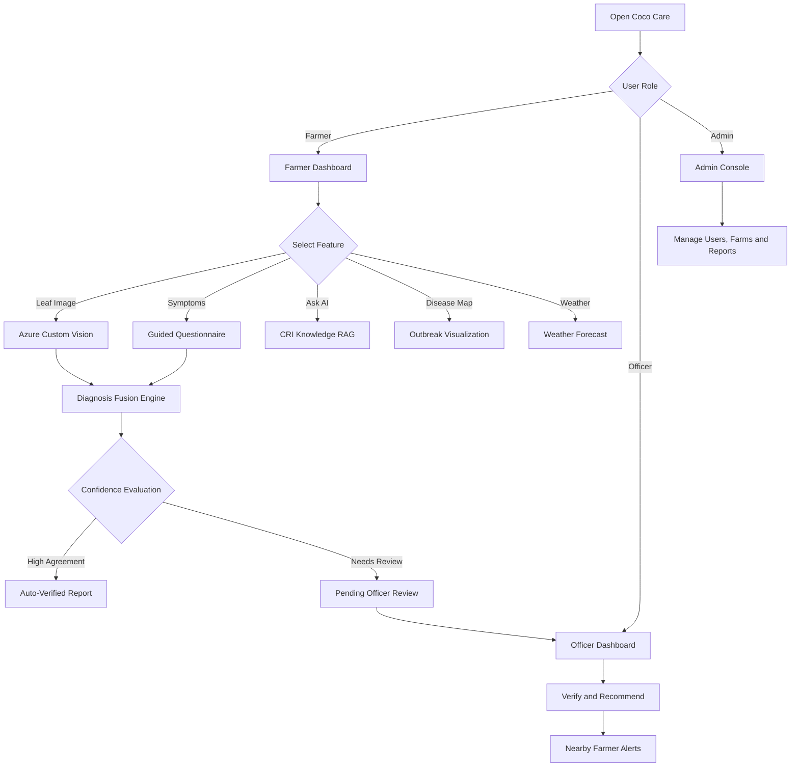
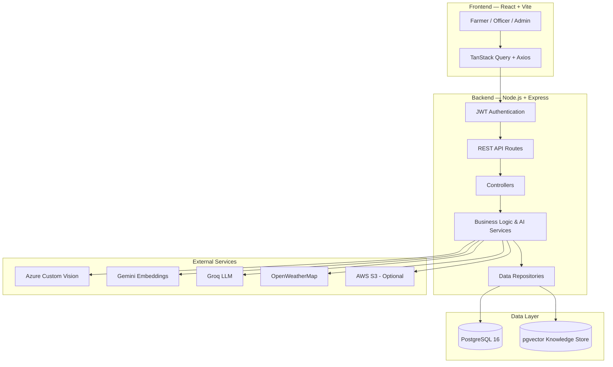
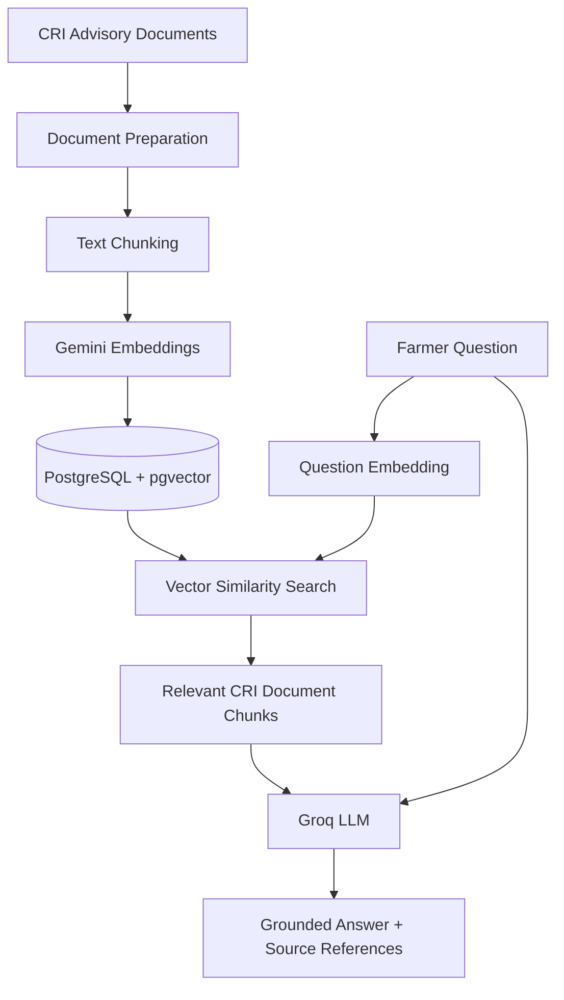

<div align="center">

# 🥥 Coco Care

### Smart Coconut Farming, Powered by AI

**Detect diseases early. Get research-grounded advice. Protect every tree.**

An AI-powered coconut health platform combining intelligent disease diagnosis, agricultural knowledge retrieval, and real-time farm monitoring.

[](https://d2qjqi3wenjlo5.cloudfront.net)
[](https://react.dev/)
[](https://www.typescriptlang.org/)
[](https://www.postgresql.org/)
[](#rag-knowledge-base)

**[Live Application](https://d2qjqi3wenjlo5.cloudfront.net)** · **[Source Code](https://github.com/pathumsanjaya/Coco-care)** · **[Report an Issue](https://github.com/pathumsanjaya/Coco-care/issues)**

</div>

---

## 🌱 Overview

**Coco Care** is an AI-powered agricultural platform designed to help coconut farmers identify plant diseases, receive reliable guidance, and collaborate with agricultural officers.

Traditional disease identification can be time-consuming and dependent on expert availability. Coco Care brings together **computer vision, retrieval-augmented generation (RAG), symptom analysis, and geographic monitoring** in one integrated platform.

The system supports three primary user roles:

| User | Experience |
|------|------------|
| 👨‍🌾 **Farmer** | Diagnose diseases, consult the AI assistant, monitor farm conditions, and track reports |
| 👨‍🔬 **Agricultural Officer** | Review diagnoses, verify disease reports, provide recommendations, and issue nearby alerts |
| 🛡️ **Administrator** | Manage users, farms, disease reports, notifications, and system operations |

The platform aims to make agricultural support more accessible, timely, and data-informed.

---

## 🚀 Live Demo

**Experience Coco Care:**

### **[→ Launch Coco Care](https://d2qjqi3wenjlo5.cloudfront.net)**

Explore the platform through its three role-based experiences.

| Dashboard | What to explore |
|-----------|-----------------|
| **Farmer** | Leaf diagnosis, symptom questionnaires, AI chatbot, weather, disease map |
| **Officer** | Submitted reports, diagnosis verification, agricultural advice, outbreak alerts |
| **Admin** | User management, farms, reports, notifications, system health |

> **Note:** AI predictions and generated advice are intended to support agricultural decision-making, not replace qualified professional diagnosis.

<!--
PROJECT SHOWCASE

For the best visual presentation, add real application screenshots
to a docs/screenshots/ directory and include them here.

Recommended screenshots:
- Farmer dashboard
- AI leaf disease diagnosis
- RAG chatbot with citations
- Disease heatmap
- Officer verification dashboard

Do not publish screenshots containing real personal or farm data.
-->

---

## ✨ Key Features

### 1. 🔬 AI-Powered Disease Diagnosis

Identify potential coconut diseases through two complementary methods.

- Upload coconut leaf images for classification using **Azure Custom Vision**.
- Answer guided symptom questionnaires for stem, bud, fruit, and general conditions.
- Combine visual and symptom evidence through a confidence-based fusion engine.
- Route diagnoses requiring human evaluation to agricultural officers.

**Benefit:** Helps farmers identify potential problems earlier and request expert review when needed.

### 2. 🤖 CRI-Grounded AI Assistant

Ask agricultural questions through a chatbot powered by **Retrieval-Augmented Generation (RAG)**.

- Retrieves relevant information from Coconut Research Institute (CRI) advisory materials.
- Generates contextual answers using Groq-hosted language models.
- Uses Gemini embeddings and PostgreSQL with pgvector for semantic retrieval.
- Provides references to retrieved source material.

**Benefit:** Makes agricultural reference information easier to access and understand.

### 3. 🗺️ Regional Disease Heatmap

Visualize disease activity through an interactive geographic interface.

- Displays reported and verified outbreaks.
- Uses **Leaflet** for interactive map visualization.
- Helps identify areas experiencing disease activity.
- Supports geographically informed monitoring.

**Benefit:** Helps farmers and officers understand disease patterns across regions.

### 4. 🌦️ Location-Based Weather Forecasts

Access weather information relevant to agricultural planning.

- Integrates **OpenWeatherMap** forecasts.
- Displays location-specific weather conditions.
- Provides weather context directly within the farmer dashboard.

**Benefit:** Supports better scheduling of farm activities.

### 5. 👨‍🔬 Agricultural Officer Verification

Connect farmers with agricultural officers through a structured review process.

- Farmers submit disease reports.
- Officers review diagnosis results and symptoms.
- Officers verify reports and provide advice.
- Verified cases can trigger alerts to nearby farmers.

**Benefit:** Combines automated analysis with human expertise.

### 6. 🔐 Role-Based Dashboards

Separate interfaces for different responsibilities.

| Role | Route |
|------|-------|
| Farmer | `/app` |
| Agricultural Officer | `/officer` |
| Administrator | `/admin` |

The backend uses JWT authentication, password hashing, request validation, and role-based middleware.

### 7. 📢 Monitoring and Notifications

Support disease awareness through reporting and notification workflows.

- Track submitted diagnosis reports.
- Maintain report verification states.
- Generate nearby disease alerts using configurable geographic radius rules.
- Manage notification broadcasts from the administration interface.

---

## 🧭 Application Workflow



The diagnostic workflow combines automated classification, symptom analysis, and officer verification.

---

## 🏗️ System Architecture

Coco Care follows a **modular monolithic architecture**, separating frontend presentation, API routing, business logic, data access, and external AI integrations.



### Backend Design

The application follows a layered request-processing pattern:

```text
HTTP Request
     │
     ▼
   Routes
     │
     ▼
 Controllers
     │
     ▼
  Services
     │
     ▼
 Repositories
     │
     ▼
 PostgreSQL / pgvector
```

This separation organizes API handling, application logic, database operations, and external service integrations.

### Core Engineering Concepts

- Modular backend design
- RESTful API development
- JWT authentication and role-based authorization
- Relational database design
- Vector similarity search
- AI service orchestration
- Automated API testing
- Confidence-based diagnosis workflows
- Geographic disease monitoring

---

## 🛠️ Tech Stack

| Layer | Technologies |
|-------|--------------|
| **Frontend** | React 18, TypeScript, Vite 6, React Router 7 |
| **UI & Styling** | Tailwind CSS v4, shadcn/ui, Radix UI, Material UI |
| **State & HTTP** | TanStack Query, Axios |
| **Visualization** | Leaflet, Recharts, Motion |
| **Backend** | Node.js 20+, Express 4, TypeScript |
| **Database** | PostgreSQL 16, pgvector |
| **Authentication** | JWT, bcrypt, Zod |
| **Computer Vision** | Azure Custom Vision |
| **Embeddings** | Google Gemini |
| **LLM Inference** | Groq |
| **Weather API** | OpenWeatherMap |
| **Object Storage** | AWS S3 (optional) |
| **Testing** | Jest, Supertest |
| **Infrastructure** | Docker Compose, AWS CloudFront |

### AI Pipeline

**Gemini Embeddings → PostgreSQL/pgvector → Groq LLM**

The configured Groq model in the project documentation is `llama-3.3-70b-versatile`.

---

## ⚡ Quick Start

Follow these instructions to run Coco Care locally.

### Prerequisites

Ensure that the following are installed:

- **Node.js 20+**
- **npm 10+**
- **Docker Engine / Docker Desktop** with Docker Compose
- Git

You will also need the applicable API credentials:

- Google Gemini
- Groq
- Azure Custom Vision
- OpenWeatherMap
- AWS S3 (optional)

### 1. Clone the Repository

```bash
git clone https://github.com/pathumsanjaya/Coco-care.git
cd Coco-care
```

### 2. Configure the Backend

Open a terminal in the repository root.

```bash
cd backend

npm install

cp .env.example .env
```

Edit `.env` with your database configuration, JWT secret, and required API credentials.

> Never commit `.env` files or production credentials to Git.

### 3. Start the Database

```bash
npm run db:up
```

This starts the Docker-based PostgreSQL 16 database with pgvector support.

The documented local database port is **5433**.

Apply the schema and seed the development data:

```bash
npm run db:migrate
npm run db:seed
```

### 4. Start the Backend

```bash
npm run dev
```

Backend API:

```text
http://localhost:3000
```

### 5. Configure and Start the Frontend

Open a **second terminal** in the repository root.

```bash
cd front_end

npm install

cp .env.example .env
```

In `front_end/.env`, configure:

```dotenv
VITE_API_BASE_URL=http://localhost:3000
```

Start the development server:

```bash
npm run dev
```

Open the frontend:

```text
http://127.0.0.1:5173
```

### Local Services

| Service | Address |
|---------|---------|
| Frontend | `http://127.0.0.1:5173` |
| Backend API | `http://localhost:3000` |
| PostgreSQL | `localhost:5433` |

### Demo Accounts

The local database seed provides development-only accounts.

| Username | Role |
|----------|------|
| `akeel` | Farmer |
| `officer1` | Agricultural Officer |
| `admin` | Administrator |

The documented seed password for these local demo accounts is `password`.

> **Security:** These accounts are for an isolated local development environment. Never expose default demo credentials in a production deployment. Change seeded passwords and use securely managed production accounts.

---

## ⚙️ Environment Configuration

Environment variable templates are maintained in:

- [`backend/.env.example`](backend/.env.example)
- [`front_end/.env.example`](front_end/.env.example)

### Backend Configuration

| Variable | Purpose |
|----------|---------|
| `PORT` | Backend HTTP port, default `3000` |
| `DATABASE_URL` | PostgreSQL connection string |
| `JWT_SECRET` | JWT signing secret |
| `JWT_EXPIRES_IN` | JWT expiration configuration |
| `FRONTEND_ORIGINS` | Permitted frontend origins for CORS |
| `FUSION_CONFIDENCE_THRESHOLD` | Confidence threshold for automatic verification |
| `AZURE_CV_ENDPOINT` | Azure Custom Vision endpoint |
| `AZURE_CV_KEY` | Azure Custom Vision API key |
| `AZURE_CV_PREDICTION_URL` | Vision prediction endpoint |
| `GEMINI_API_KEY` | Gemini embeddings access |
| `GEMINI_EMBEDDING_MODEL` | Embedding model selection |
| `GEMINI_EMBEDDING_DIMENSIONS` | Vector dimension configuration |
| `RAG_TOP_K` | Maximum retrieved knowledge chunks |
| `RAG_MIN_SCORE` | Minimum retrieval similarity score |
| `KNOWLEDGE_DATA_DIR` | Directory containing CRI knowledge files |
| `GROQ_API_KEY` | Groq API credentials |
| `GROQ_MODEL` | Language model selection |
| `OPENWEATHER_API_KEY` | Weather service credentials |
| `AWS_REGION` | Optional AWS region |
| `AWS_S3_BUCKET` | Optional image storage bucket |
| `DISEASE_ALERT_RADIUS_KM` | Geographic radius for nearby disease alerts |

### Frontend Configuration

| Variable | Purpose |
|----------|---------|
| `VITE_API_BASE_URL` | Backend API base URL |
| `VITE_GOOGLE_MAPS_KEY` | Optional Google Maps API key |

The backend `.env.example` and frontend `.env.example` files are the authoritative configuration references.

---

## 🧠 RAG Knowledge Base

One of Coco Care's core components is its agricultural knowledge assistant.

Instead of relying exclusively on an LLM's general knowledge, the system retrieves information from **Coconut Research Institute advisory documents** to provide context-grounded responses.

### RAG Workflow



### Knowledge Coverage

The knowledge base contains prepared material covering topics such as:

- Coconut nutrient requirements and fertilizer recommendations
- Organic fertilizers and basal mixtures
- Bud rot
- Weligama leaf wilt disease
- Black beetle and red palm weevil
- Coconut caterpillar and leaf miner

Source material is organized under:

```text
backend/data/cri-manuals/cri/
```

### Refresh the Knowledge Base

From the backend directory:

```bash
npm run rag:prepare
```

Prepare the topic files from source manuals when required.

To clear and rebuild the knowledge embeddings:

```bash
npm run rag:clear
npm run rag:ingest
```

The database seed process also supports knowledge ingestion when the knowledge tables are empty.

> The retrieval system is designed to ground generated responses in CRI material. As with any AI-assisted system, critical recommendations should be checked against the original sources and qualified agricultural advice.

---

## 📁 Project Structure

```text
Coco-care/
│
├── backend/
│   ├── src/
│   │   ├── modules/         # Feature modules and API endpoints
│   │   ├── services/        # Business logic and AI integrations
│   │   ├── repositories/    # Database access layer
│   │   ├── middleware/      # Auth, validation, and errors
│   │   ├── db/              # Database connections and setup
│   │   └── config/          # Environment configuration
│   │
│   ├── sql/                 # Database migrations
│   ├── data/
│   │   └── cri-manuals/     # CRI knowledge source files
│   ├── scripts/             # RAG preparation and ingestion
│   ├── tests/               # Jest and Supertest tests
│   └── docker-compose.yml   # PostgreSQL and pgvector
│
├── front_end/
│   ├── src/
│   │   ├── app/
│   │   │   ├── pages/       # Farmer, officer, admin pages
│   │   │   ├── components/  # Reusable UI components
│   │   │   ├── layouts/     # Dashboard layouts
│   │   │   └── routes.tsx   # Role-gated routes
│   │   ├── api/             # HTTP clients
│   │   ├── contexts/        # Authentication context
│   │   ├── routes/          # Protected routes
│   │   └── styles/          # Application styles
│   └── public/
│
└── README.md
```

---

## 🧪 Development & Testing

### Backend Scripts

Run these commands inside `backend/`.

| Command | Description |
|---------|-------------|
| `npm run dev` | Run the API in development mode |
| `npm run build` | Compile the TypeScript backend |
| `npm start` | Start the compiled backend |
| `npm run db:up` | Start the PostgreSQL container |
| `npm run db:down` | Stop the database container |
| `npm run db:reset` | Reset database volume and development data |
| `npm run db:migrate` | Apply SQL migrations |
| `npm run db:seed` | Seed development data |
| `npm run rag:prepare` | Prepare RAG knowledge files |
| `npm run rag:ingest` | Generate and store embeddings |
| `npm run rag:clear` | Clear the knowledge tables |
| `npm run test` | Execute Jest and Supertest tests |

Tests requiring PostgreSQL need a running database and suitable test configuration.

### Frontend Scripts

Run these commands inside `front_end/`.

| Command | Description |
|---------|-------------|
| `npm run dev` | Start the Vite development server |
| `npm run build` | Build production frontend assets |

### Testing Approach

The backend uses:

- **Jest** for automated testing.
- **Supertest** for HTTP API testing.
- Database-dependent tests for backend functionality where applicable.

Run backend tests with:

```bash
cd backend
npm run test
```

---

## 🗺️ Roadmap

Potential future improvements include:

- [ ] Mobile-first Progressive Web App
- [ ] Offline diagnosis queue with synchronization
- [ ] Multilingual UI (Sinhala, Tamil, English)
- [ ] SMS and WhatsApp disease alerts
- [ ] Yield and treatment outcome tracking
- [ ] Expanded disease recognition for stem, bud, and fruit images
- [ ] Officer territory and workload management
- [ ] Exportable farm-health PDF reports

These are planned improvements, not descriptions of currently implemented features.

---

## 🤝 Contributing

Contributions, suggestions, and bug reports are welcome.

1. Fork the repository.
2. Create a feature branch.

   ```bash
   git checkout -b feature/your-feature
   ```

3. Implement and test your changes.
4. Run applicable backend tests.

   ```bash
   cd backend
   npm run test
   ```

5. Commit your changes and push your branch.
6. Open a Pull Request describing the change.

For UI updates, include screenshots where possible.

For backend changes, preserve the existing layered architecture:

```text
Routes → Controllers → Services → Repositories
```

For bug reports or feature requests, use the [GitHub Issues page](https://github.com/pathumsanjaya/Coco-care/issues).

---

## 📄 License

This repository is currently presented for **educational and demonstration purposes**.

No explicit open-source license is included in the supplied repository documentation. Until a license is added, standard copyright restrictions apply.

For reuse or redistribution permissions, contact the project maintainers.

---

## 👥 Project Team

Coco Care was developed as a collaborative project by a team of five.

**Pathum Sanjaya Bandara**  
*Backend Developer & Team Coordinator*

Contributions included:

- Developing Node.js, Express, and TypeScript REST APIs
- Implementing the RAG pipeline with Gemini, PostgreSQL, pgvector, and Groq
- Integrating Azure Custom Vision for disease classification
- Writing API tests using Jest and Supertest
- Coordinating team tasks and development progress

---

<div align="center">

### 🌴 Healthier Coconut Farms Through Smarter Technology

**Detect Early · Act Confidently · Protect Every Tree**

Built with technology, research, and a commitment to practical agricultural innovation.

</div>
